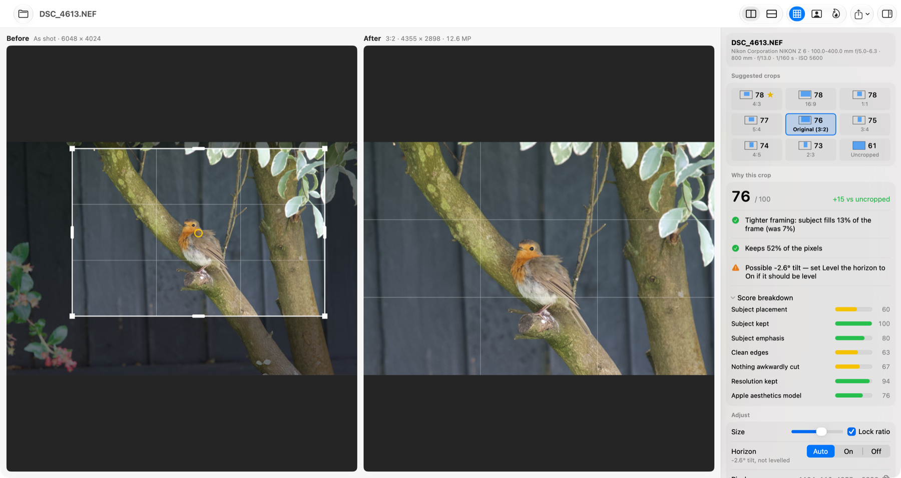
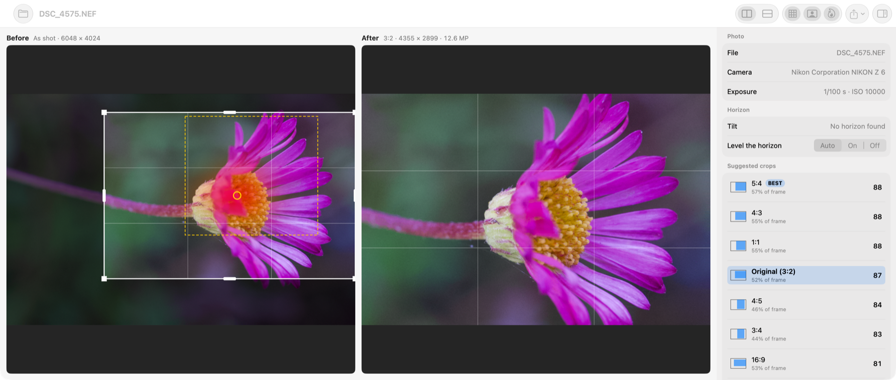
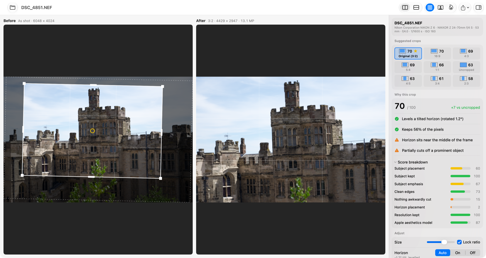
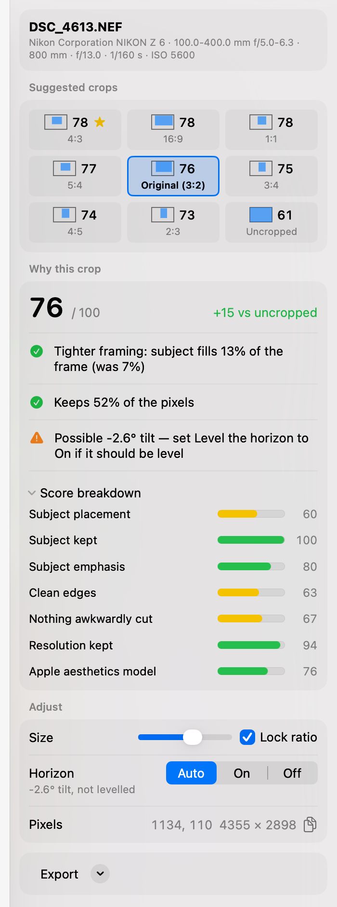

# Crop Advisor

A macOS app that analyses a Nikon NEF (or any RAW/JPEG/HEIC) photo and suggests crops that
strengthen its composition, with side-by-side **Before** / **After** previews.



## Screenshots

**Suggested crop, before and after.** The Before view shows the photo as shot, with the crop, a
rule-of-thirds grid and the detected focal point (yellow ring). The After view shows the result.
The sidebar ranks a crop for every standard aspect ratio. It opens on the camera's own ratio, and
the highest scorer is tagged **BEST**.

**Overlays.** The saliency heat map shows where the eye is drawn, and the detection overlay marks
subjects (dashed boxes), faces, gaze direction and limb joints.



**Horizon levelling.** A tilted horizon is levelled automatically for scenes that look like
landscapes. The crop is drawn rotated on the original, exactly where it will be cut, and the
After view is straight.



**The advice.** Each crop has a score, the reasons it works, any warnings, its exact pixel bounding
box and a per-guideline breakdown.



## Build & run

Requires macOS 15+. Works with just the Command Line Tools (no Xcode needed):

```sh
./build_app.sh            # -> build/CropAdvisor.app
open build/CropAdvisor.app
```

The app icon is drawn in code: edit `scripts/make_icon.swift`, then run `scripts/make_icon.sh`
to regenerate `Resources/AppIcon.icns`.

Open a photo with ⌘O, drag it onto the window, or use Finder's *Open With ▸ CropAdvisor*.

## How it works

Crop Advisor combines Apple's on-device machine learning, which works out *what is in* the photo,
with hand-written rules, which judge *what makes a good crop*. It uses no third-party libraries,
cloud services or general-purpose AI models, so everything runs locally on the Mac.

### 1. Perception: Apple's Vision framework

`SceneAnalyzer.swift` runs the detectors built into macOS on a 1600px copy of the photo:

| Vision request | Used for |
|---|---|
| Attention-based saliency | A heat map of where a viewer's eye is likely to go; drives most of the scoring |
| Objectness-based saliency | Boxes around distinct objects, the candidate subjects |
| Face landmarks | Face boxes, eye positions, and which way the head is turned (from where the nose sits) |
| Human rectangles and body pose | People, plus elbow, wrist, knee, ankle and neck positions |
| Animal recognition | Cats and dogs only; other animals, such as birds, are treated as generic objects |
| Horizon detection | The tilt angle used for levelling |

The main subject is the detected face, animal or object that holds the most attention, and the
*focal point* is its eyes or its saliency peak.

### 2. Judgement: composition rules

The models know nothing about composition. `CropEngine.swift` scores every candidate crop against
standard cropping guidelines.
Each guideline is scored from 0 to 100 and weighted into an overall score:

| Guideline | Weight | How it's measured |
|---|---|---|
| Subject placement | 22% | Eyes on the upper third line (portraits) or main subject on a thirds intersection; deliberate centring scores a little less |
| Subject kept | 16% | Share of the attention-saliency map kept inside the crop |
| Subject emphasis | 14% | How well the subject fills the frame (about 28% is ideal) without being cramped |
| Clean edges | 12% | Bright, salient or busy strips along each border that pull the eye out of the frame |
| Room to look into | 10% | Space in front of a face, in the direction it is turned |
| Resolution kept | 10% | Penalises heavy crops that would hurt prints |
| Nothing awkwardly cut | 8% | Salient objects sliced part-way by an edge |
| Horizon placement | 7% | A strong light/dark boundary on a third line rather than through the middle |
| Avoids cutting at joints | 6% | Edges passing close to elbows, wrists, knees, ankles or the neck |

Guidelines that don't apply, such as lead room with no face, are left out and the rest are
reweighted. The weights are judgement calls, not learned from data; tune them in `Criterion.weight`.

Hard rules: faces (and cats and dogs) are never cut, the focal point stays clear of the edges, and at
least 20% of the frame is kept.

### 3. Search

For each standard ratio (original, 3:2, 4:3, 5:4, 1:1, 16:9 and their portrait versions), the
engine tries crops at many sizes and positions on a 2% grid. That's around 200,000 candidates, and
it then fine-tunes the best four. Scoring is fast because the heat map and image statistics are
pre-summed (summed-area tables), so each rule needs only a few lookups. A full search takes about
10 ms.

### 4. Second opinion: Apple's aesthetics model

The best crop for each ratio is cut out and rated by Apple's on-device image-aesthetics model, a
learned "how good does this photo look" score. It makes up 20% of the final score, and the rules
make up the other 80%. It appears as *Apple aesthetics model* in the score breakdown.

### Horizon levelling

Vision's horizon detector also fires on perspective lines such as roads and tables, so *Auto* only
levels scenes with a bright sky and no people. Otherwise it shows a hint, and you can set
*Level the horizon* to *On*.

### Strengths and limitations

- **Explainable:** every score maps to a named guideline, so the app can say *why* a crop works
  ("Places the subject's eyes on the upper third line"), and its behaviour is changed by editing
  rules, not retraining a model.
- **Only as good as the detectors:** people in crowds or small in the frame are sometimes missed, and
  animals other than cats and dogs count as generic objects.
- **Rules are simplifications:** there is no sense of storytelling, leading lines or colour balance.
  Stronger judgement would need a learned crop-ranking model or a vision-capable LLM, at the cost of
  explainability and fully offline operation.

## Using it

- Pick any suggestion in the sidebar to see why it works, plus any warnings.
- In the Before view, drag inside the crop to move it, or drag a corner or edge handle to resize it.
  The aspect ratio is locked by default; hold ⇧ or turn off *Lock aspect ratio* to resize freely.
  Pinching or the size slider also resize it. Scores update live.
- Toolbar toggles: thirds grid, detections overlay (faces, gaze, subjects, joints, horizon),
  saliency heat map, side-by-side or stacked layout.
- **Export** (⌘E) re-develops the RAW at full resolution and writes a cropped JPEG, 16-bit TIFF or HEIC
  with the camera's EXIF. The NEF is never modified.

## Command line

```sh
build/CropAdvisor --analyze photo.NEF [--level auto|on|off] [--export best.jpg]
build/CropAdvisor --snapshot photo.NEF ui.png [--detections] [--heatmap] [--stacked]
```

`--snapshot` renders the window to a PNG; it is how the screenshots above were made, e.g.
`SNAP_WIDTH=1700 SNAP_HEIGHT=640 build/CropAdvisor --snapshot photo.NEF main.png`, then
`sips -Z 1800 main.png`.

## Source layout

- `ImageLoader.swift`: RAW decode (CIRAWFilter), metadata, horizon straightening
- `SceneAnalyzer.swift`: Vision saliency, faces and gaze, people, pose, animals, horizon line
- `CropEngine.swift`: guideline scoring, candidate search and plain-English advice
- `Pipeline.swift`: analysis pipeline, aesthetics re-ranking, full-resolution export
- `AppModel.swift`, `ContentView.swift`, `PreviewViews.swift`, `InspectorView.swift`: SwiftUI app

Note: `Package.swift` is provided for Xcode users. The Command Line Tools on this machine have a
mismatched SwiftPM manifest library, so `build_app.sh` calls `swiftc` directly. View state lives in
the `@Observable` model rather than `@State`, because the CLT SDK lacks SwiftUI's macro plugin.
